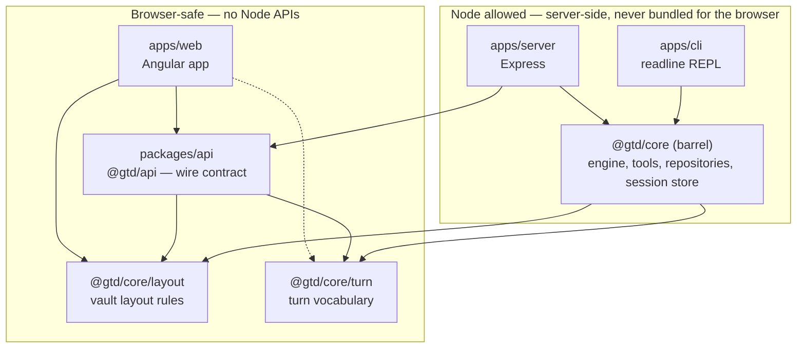

# Development guide

How the workspace is cut, which package may import which, what the contract
between server and client is, and where Node APIs are allowed. Product and
runtime design live in [`docs/specs/architecture.md`](specs/architecture.md);
this page is about the code's boundaries and why they are where they are.

## Packages and the dependency direction



Arrows point from the importer to the imported package. The dotted edge is
allowed but not used yet. "Node allowed" means exactly that: the barrel may
use Node APIs and parts of it do (`LocalFileRepository`, `FsSessionStore`, the
turn artifacts); the engine, tools and prompts in it are runtime-neutral and
see only the `FileRepository`/`SessionStore` interfaces. A Node-free
implementation such as a Supabase-backed store may live on that side too —
its consumer is the server, and nothing there is bundled for a browser.

| Importer | May import | Must not import | Why |
|---|---|---|---|
| `apps/web` | `@gtd/api`, `@gtd/core/layout`, `@gtd/core/turn` | the `@gtd/core` barrel, anything from `apps/server` | The bundle must stay Node-free; the web talks to the server over HTTP only. |
| `packages/api` | `@gtd/core/layout`, `@gtd/core/turn` | `node:*`, the `@gtd/core` barrel | Both sides compile against it, so it must be loadable in a browser. |
| `apps/server` | `@gtd/api`, `@gtd/core` | `apps/web` | The adapter between the engine and the wire: it maps engine results to events and HTTP codes. |
| `apps/cli` | `@gtd/core` | `@gtd/api` | The CLI has no HTTP surface; it is the second entrypoint of the same engine. |
| `@gtd/core` barrel | `node:*`, `ai`, `zod`, its own entries | `@gtd/api`, any app | The root of the graph; Node is allowed here, not required. |
| `@gtd/core/layout`, `@gtd/core/turn` | nothing outside their own folder | everything else | Proven Node-free by their own `tsconfig` (below). |

## Why two browser-safe core entries instead of copies

The engine's vocabulary — what kind of turn ran, how it ended, which tools
render as rows, what a quick-reply result looks like — is needed by the
engine, the session file, the wire contract and every client. A copy in
`@gtd/api` that merely *equals* the core type drifts silently; a pin test
that asserts equality only reports the drift. A type that must be the same
is the same type, so core exposes it from an entry the browser can load.

What lives where:

- **`@gtd/core/layout`** — the vault layout rules without Node: GTD task file
  paths, daily-note dates, `IsoDate`, `offsetDate`. Added in Task 3.1 for the
  web's vault screens.
- **`@gtd/core/turn`** — the turn pipeline's vocabulary: `TurnKind`/
  `TURN_KINDS`, `TurnResult`, `TurnOutcome`, `TurnErrorPhase`,
  `QuickRepliesResult`, `VaultToolName`/`VAULT_TOOL_NAMES` (the tools that
  render as rows), `QUICK_REPLIES_TOOL_NAME` (the protocol tool) and
  `ToolName` (both together: everything the engine hands to the model). The
  `TurnSink` observer interface stays in the barrel: only the engine and its
  hosts observe a turn. Added in Task 6.1 when the chat went on the wire.
- **`@gtd/api`** — the HTTP/SSE shapes: request and response bodies, the
  closed `ApiErrorCode` set, the `SessionEvent` union. It re-exports the turn
  vocabulary rather than declaring its own.
- **`@gtd/core` barrel** — everything that needs Node or the model: the turn
  engine, tools, `LocalFileRepository`, `FsSessionStore`, prompts, pruning,
  and the model provider (`selectModel`, `createModelProvider`): one table
  of providers, default models, API-key variables and tool-dispatch options
  for the CLI and the server.

How the boundaries are enforced:

- `packages/core/tsconfig.layout.json` and `tsconfig.turn.json` compile the
  two entry folders with `types: []` and `lib: ["ES2022"]`: any `node:*` import
  or Node global fails `pnpm -C packages/core typecheck`. Nothing in those
  folders may import from outside the folder.
- `packages/api/tsconfig.json` has `types: []`, so a direct `node:*` import
  fails. The barrel rule is kept by review — a type-only import of the barrel
  would still compile because it reaches only `.d.ts` files — and `ng build`
  fails if Node code ends up in the web bundle.
- `buildTools` in `packages/core/src/tools.ts` is `satisfies Record<ToolName,
  Tool>`: a tool added or renamed without a vocabulary entry does not compile
  (missing key and extra key alike, because the target type has no index
  signature), so server and web can never render a tool the engine does not
  have, or miss one it has.
- pnpm's strict `node_modules` and `workspace:*` enforce the package direction
  itself: a package can only import what its `package.json` declares.

## The contract between server and client

`@gtd/api` is the whole contract. The server throws `ApiError(status, code,
message)` and emits `SessionEvent`s; the web reads codes and events, never
server-authored text.

- **Errors.** Every error response is `{ error: { code, message, requestId } }`
  with `code` from `API_ERROR_CODES`. `requestId` equals the `X-Request-Id`
  response header and the server log lines of that request, so a user-visible
  error can be matched to the log. `message` is developer-facing English; the
  web renders catalog copy keyed by `code` (`apps/web/public/i18n/`).
- **Reads.** `GET /api/files/{path}` → `FileContentBody`; `GET /api/daily-notes`
  → `DailyNoteRef[]`. Paths are validated against the GTD layout on the server
  (`invalid_path`, `path_out_of_scope`, `file_not_found`).
- **Chat: command/event split.** `POST /api/chat` is a command answered with
  202 `{ turnId }`; it never streams. Everything a turn produces flows through
  `GET /api/chat/stream` as server-sent events: `id:` is the monotonic `seq`
  of the user-day event log, `event:` the `SessionEvent.type`, `data:` the
  event as JSON. `turn-start` carries the user's text, so every client of the
  user renders the message from the stream, including the one that sent it.
  One turn per user at a time (`409 turn_in_flight`); a dropped stream only
  unsubscribes — the turn completes and persists regardless, and only
  `POST /api/chat/cancel` aborts it. A `?cursor=<seq>` resumes after the last
  seen id; a cursor the server cannot serve (older than the retained log, or
  after a restart) gets one `resync` control event, after which the client
  reloads the session and attaches again.
- **Vocabulary.** `kind` (`user` | `opener`), `outcome`, `phase` and the tool
  names on the wire are the engine's own types via `@gtd/core/turn`. A change
  there is a wire change and vice versa; the server's engine-to-event mapping
  and the web's event reducer are the places the compiler catches it.
- **Change discipline.** A new error code or event field is added together
  with the site that throws or emits it, in the same commit. Codes are a
  closed set on purpose: the web's `apiErrorOf` guard returns `undefined` for
  anything outside it instead of inventing a value.
- **Auth today.** The dev path stamps every request with `DEV_USER_ID`; routes
  only ever see `req.userId`. The JWT branch of Task 9 replaces one middleware
  and nothing else.

## Where Node is allowed

- **Environment variables** are read in one place per entrypoint:
  `apps/server/src/index.ts` → `config.ts` for the server, `apps/cli/src/index.ts`
  and its `model-provider.ts` for the CLI. Everything below receives plain
  values; nothing in `packages/` touches `process.env`. (The `@ai-sdk/*`
  providers read their API key from the environment themselves, which is why
  the server verifies its presence at boot.)
- **Filesystem** access lives in `LocalFileRepository`, `FsSessionStore`,
  `apps/server/src/vault-file-version.ts` and the CLI's log writers. The
  turn engine sees only the `FileRepository` and `SessionStore` interfaces
  plus an injected `fileVersionAt` closure.
- **Logging** goes through the runtime-neutral `Logger` contract in
  `packages/core/src/logging.ts` (conventions and the code registry are in
  that file's header). The server's Pino adapter is the redaction seam: log
  lines carry metadata only — ids, counts, phases, error types — never chat
  text, vault content or provider bodies.

## Build order and checks

Packages are consumed from their `dist/` (`main`/`exports` point there), so
the order is core → api → server, web, cli:

```sh
pnpm -C packages/core build      # also needed before cli/server/api typechecks and tests
pnpm -C packages/api build       # server and web read packages/api/dist
pnpm -r typecheck                # core runs its three tsconfigs here
pnpm -r test
```

`pnpm -r build` from the root runs in topological order. After a change to a
browser-safe entry or to `@gtd/api`, rebuild core and api before running the
server or web.
